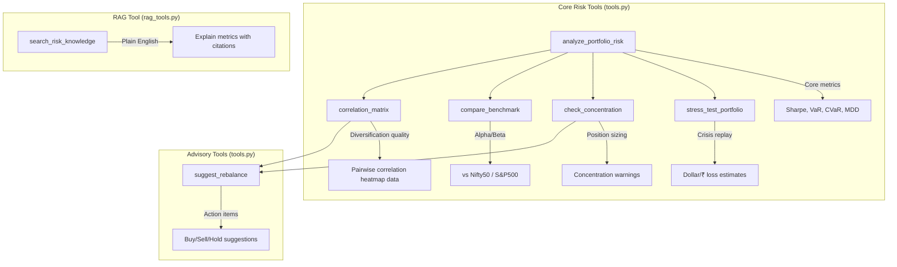

# Portfolio Risk Management

---

## 1. — What Portfolio Risk Actually Means

### 1.1 What Is a Portfolio?

Think of a portfolio like a **plate at a buffet**. Instead of one dish, you pick several — stocks, bonds, gold, mutual funds — so that if one dish tastes bad (crashes), the others keep you fed.

**Key idea:** Don't put all your eggs in one basket. This is called **diversification**.

### 1.2 What Is "Risk"?

In finance, risk doesn't mean "you'll lose money." It means **how unpredictable your returns are**. A fixed deposit that gives 7% every year has zero risk. A stock that gave +40% last year and -20% this year is "risky" — not because it's bad, but because you can't predict what comes next.

### 1.3 Return — Your Reward for Taking Risk

**Daily Return** = how much your investment changed today vs. yesterday:

$$r_t = \frac{P_t - P_{t-1}}{P_{t-1}}$$

(If the stock was ₹100 yesterday and ₹102 today, today's return is 2%.)

**Annualized Return** = what your daily average looks like stretched over a full year:

$$R_{ann} = \left(\prod_{t=1}^{N} (1 + r_t)\right)^{252/N} - 1$$

We use 252 because that's how many trading days are in a year.

> **Plain English:** If your portfolio made 0.05% per day on average, the annualized return tells you "that's roughly 13.4% per year."

### 1.4 Volatility (σ) — The Bumpiness Meter

Volatility is the **standard deviation** of your daily returns, scaled to a year:

$$\sigma_{ann} = \sigma_{daily} \times \sqrt{252}$$

| Volatility | What it feels like |
|---|---|
| < 10% | Smooth ride — bond-like |
| 10–20% | Normal stock territory |
| 20–35% | Rollercoaster — small-caps, crypto-lite |
| > 35% | Meme-stock / crypto chaos |

> **Plain English:** Volatility answers "how much does my portfolio value jump around day to day?" Higher volatility = bigger surprises (both good and bad).

### 1.5 Sharpe Ratio — Bang for Your Risk Buck

The Sharpe Ratio asks: **"For every unit of risk I took, how much extra return did I earn over a safe government bond?"**

$$\text{Sharpe} = \frac{R_{ann} - R_f}{\sigma_{ann}}$$

Where $R_f$ is the **risk-free rate** (what a government treasury bond pays — about 6.5% in India, ~4.5% in the US).

| Sharpe Ratio | Verdict |
|---|---|
| < 0 | You lost money or did worse than a fixed deposit 😬 |
| 0 – 0.5 | Below average |
| 0.5 – 1.0 | Acceptable |
| 1.0 – 2.0 | Good — most hedge funds target this |
| > 2.0 | Exceptional (or suspicious — might be overfitting) |

> **Plain English:** Sharpe = "reward per unit of stomach pain." A Sharpe of 1.5 means for every 1% of bumpiness, you got 1.5% extra return over a fixed deposit.

### 1.6 Value at Risk (VaR) — Your Worst Bad Day

VaR answers: **"On 95% of days, what's the MOST I could lose?"**

**Historical VaR (95%):** Sort all your past daily returns from worst to best. The return at the 5th percentile is your VaR.
$$\text{VaR}_{95\%} = -\text{Percentile}_{5\%}(r_1, r_2, \ldots, r_N) \times V$$

Where $V$ is your portfolio value.

> **Example:** You have ₹10,00,000 invested. Historical VaR at 95% = ₹1,47,000. This means: "On 95% of trading days, you won't lose more than ₹1.47 lakh in a single day. But on that unlucky 5% of days? Could be worse."

**Two methods we'll implement:**
1. **Historical VaR** — Uses actual past returns (no assumptions about distribution shape)
2. **Parametric VaR** — Assumes returns follow a bell curve: $\text{VaR} = V \times z_{0.95} \times \sigma_{daily}$ where $z_{0.95} = 1.645$

### 1.7 CVaR (Conditional VaR / Expected Shortfall) — When Things Go Really Wrong

VaR only tells you the **boundary** of the worst 5%. CVaR tells you the **average loss in those worst 5% of days**.

$$\text{CVaR}_{95\%} = -\text{Mean}(r_t \mid r_t \leq \text{VaR percentile}) \times V$$

> **Plain English:** VaR says "on bad days, you could lose at least ₹1.47 lakh." CVaR says "on those bad days, the average loss is actually ₹2.1 lakh." CVaR is always worse than VaR. Regulators prefer CVaR because it captures **tail risk** — the really ugly scenarios.

### 1.8 Maximum Drawdown — The Deepest Hole

Max Drawdown is the **largest peak-to-trough percentage drop** your portfolio ever suffered:

$$\text{MDD} = \max_{t} \left( \frac{\text{Peak}_t - \text{Trough}_t}{\text{Peak}_t} \right)$$

> **Analogy:** Imagine your portfolio is climbing a mountain. Sometimes it goes up, sometimes it dips. Max Drawdown is the deepest valley you ever fell into, measured from the highest peak before that fall.

| Max Drawdown | Interpretation |
|---|---|
| < 10% | Very stable (bond portfolio) |
| 10–20% | Normal for a balanced portfolio |
| 20–40% | Aggressive equity portfolio |
| > 50% | You were holding crypto in 2022 |

We also track **recovery time** — how many trading days it took to climb back to the previous peak.

### 1.9 Concentration Risk — The Hidden Bomb

Even if your portfolio has 10 stocks, if 60% of the money is in one stock, you're not really diversified.

**Rules we'll enforce:**
- **Single-asset concentration:** Any holding > 30% of portfolio value → `CONCENTRATION_HIGH`
- **Top-3 concentration:** If top 3 holdings > 70% of portfolio → `CONCENTRATION_MODERATE`
- **Sector concentration:** If one sector > 40% → `SECTOR_CONCENTRATION_WARNING` (future enhancement)

### 1.10 Correlation — When "Diversification" Is an Illusion

Two stocks might look like different investments, but if they always move together (e.g., HDFC Bank and ICICI Bank), dropping one when the other crashes means **both** crash at the same time.

$$\rho_{A,B} = \frac{\text{Cov}(r_A, r_B)}{\sigma_A \cdot \sigma_B}$$

| Correlation | Meaning |
|---|---|
| +1.0 | Perfect sync — no diversification benefit |
| 0 | Unrelated — ideal diversification |
| -1.0 | Opposite moves — perfect hedge |

> **Flag:** If average pairwise correlation > 0.7 → `HIGH_CORRELATION_WARNING` (your diversification is fake)

### 1.11 Beta — How Your Portfolio Dances with the Market

Beta measures how sensitive your portfolio is to overall market movements:

$$\beta = \frac{\text{Cov}(r_{portfolio}, r_{market})}{\text{Var}(r_{market})}$$

| Beta | Meaning |
|---|---|
| β = 1 | Moves exactly with the market |
| β > 1 | More volatile than the market (amplifies gains AND losses) |
| β < 1 | Defensive — buffers market drops |
| β < 0 | Inverse — goes up when market goes down (rare, e.g., gold sometimes) |

### 1.12 Stress Testing — What If 2008 Happens Again?

Stress testing applies **historical crisis scenarios** or **hypothetical market shocks** to your current portfolio to estimate losses.

**Historical replay scenarios:**
| Scenario | Period | What Happened |
|---|---|---|
| `2008_global_crisis` | Sep 2008 – Mar 2009 | Global financial crisis, markets dropped ~55% |
| `2020_covid_crash` | Feb 2020 – Mar 2020 | COVID panic, Nifty dropped ~38% in 1 month |
| `2022_rate_hike` | Jan 2022 – Oct 2022 | Fed rate hikes, tech stocks crushed, crypto collapsed |

**Hypothetical shock scenarios:** Apply uniform market drops (-10%, -20%, -30%) adjusted by each holding's beta.

---


##  2. — The 7 Tools You Need 


### Tool Architecture Overview



### Tool 1: `analyze_portfolio_risk` (The Core Engine)

**What the user asks:** "Analyze my portfolio: 40% RELIANCE.NS, 30% TCS.NS, 20% HDFCBANK.NS, 10% GOLD"

**What the tool does:**
1. Parses the holdings JSON
2. Fetches 3 years of daily price history via `yfinance`
3. Computes daily returns for each asset
4. Computes **weighted portfolio daily returns**
5. Calculates ALL of these metrics:
   - Annualized Return
   - Annualized Volatility
   - Sharpe Ratio (using configurable risk-free rate)
   - Historical 95% VaR (in ₹ or $)
   - CVaR / Expected Shortfall (in ₹ or $)
   - Maximum Drawdown (% and recovery days)
   - Concentration warnings

**Function signature:**
```python
async def analyze_portfolio_risk(
    holdings_json: str,       # '{"RELIANCE.NS": 0.40, "TCS.NS": 0.30, "HDFCBANK.NS": 0.20, "GOLD": 0.10}'
    portfolio_value: float,   # 1000000.0 (total invested in base currency)
    period: str = "3y",       # yfinance period: "1y", "2y", "3y", "5y", "max"
) -> str:
```

**Returns:** Structured JSON string with both raw numbers and plain-English flags:
```json
{
  "annualized_return": 0.142,
  "annualized_volatility": 0.189,
  "sharpe_ratio": 0.407,
  "var_95_pct": 0.0187,
  "var_95_amount": 18700.00,
  "cvar_95_pct": 0.0243,
  "cvar_95_amount": 24300.00,
  "max_drawdown_pct": 0.284,
  "max_drawdown_recovery_days": 142,
  "flags": ["SHARPE_BELOW_1", "DRAWDOWN_MODERATE"],
  "holdings_analyzed": 4,
  "period_used": "3y",
  "data_start": "2023-11-28",
  "data_end": "2026-11-28"
}
```

**The key math inside (portfolio returns):**

$$r_{portfolio,t} = \sum_{i=1}^{n} w_i \cdot r_{i,t}$$

Where $w_i$ is the weight of asset $i$ and $r_{i,t}$ is asset $i$'s return on day $t$.

---

### Tool 2: `stress_test_portfolio` (Crisis Simulator)

**What the user asks:** "What would happen to my portfolio in a 2008-style crash?"

**What the tool does:**
1. Looks up predefined crisis windows (or takes a hypothetical % drop)
2. For historical scenarios: fetches actual returns during that crisis period and applies them
3. For hypothetical drops: uses each holding's **beta** to estimate how much IT would drop if the market drops -10/-20/-30%
4. Reports per-holding and total portfolio estimated loss

**Function signature:**
```python
async def stress_test_portfolio(
    holdings_json: str,          # Same format as above
    portfolio_value: float,      # 1000000.0
    scenario: str = "2022_rate_hike",  # "2008_global_crisis" | "2020_covid_crash" | "2022_rate_hike" | "hypothetical"
    hypothetical_drop_pct: float = 20.0,  # Only used when scenario="hypothetical"
) -> str:
```

**Beta-adjusted hypothetical loss:**

$$\text{Loss}_i = w_i \times V \times \beta_i \times \frac{\text{drop}}{100}$$

---

### Tool 3: `check_concentration` (Position Sizing Guard)

**What the user asks:** "Am I too concentrated in any single stock?"

**What the tool does:**
1. Checks if any single holding > 30% of portfolio
2. Checks if top 3 holdings > 70%
3. Computes a Herfindahl-Hirschman Index (HHI) for the portfolio

**HHI formula:**

$$\text{HHI} = \sum_{i=1}^{n} w_i^2$$

| HHI | Interpretation |
|---|---|
| < 0.15 | Well diversified |
| 0.15–0.25 | Moderately concentrated |
| > 0.25 | Highly concentrated |

**Function signature:**
```python
async def check_concentration(
    holdings_json: str,  # '{"RELIANCE.NS": 0.40, "TCS.NS": 0.30, ...}'
) -> str:
```

---

### Tool 4: `compare_benchmark` (Are You Beating the Market?)

**What the user asks:** "How does my portfolio compare to the Nifty 50?"

**What the tool does:**
1. Fetches benchmark index returns (Nifty 50 = `^NSEI`, S&P 500 = `^GSPC`)
2. Computes portfolio alpha (excess return above benchmark)
3. Computes portfolio beta (sensitivity to benchmark)
4. Computes tracking error (how closely you follow the benchmark)

**Alpha formula:**

$$\alpha = R_{portfolio} - (\beta \times R_{benchmark})$$

> Positive alpha = you beat the market. Negative = you underperformed.

**Function signature:**
```python
async def compare_benchmark(
    holdings_json: str,
    portfolio_value: float,
    benchmark: str = "^NSEI",  # "^NSEI" for Nifty 50, "^GSPC" for S&P 500
    period: str = "3y",
) -> str:
```

---

### Tool 5: `correlation_matrix` (Diversification Quality Check)

**What the user asks:** "Are my holdings actually diversified or do they all move together?"

**What the tool does:**
1. Fetches price history for all holdings
2. Computes pairwise Pearson correlation matrix
3. Flags high-correlation pairs (> 0.7)
4. Computes average pairwise correlation

**Function signature:**
```python
async def correlation_matrix(
    holdings_json: str,
    period: str = "3y",
) -> str:
```

**Returns:** A formatted matrix + warnings like `HIGH_CORRELATION: RELIANCE.NS ↔ ONGC.NS (0.82)`

---

### Tool 6: `suggest_rebalance` (Actionable Advice)

**What the user asks:** "My portfolio is too risky. What should I change?"

**What the tool does:**
1. Takes current risk metrics (from `analyze_portfolio_risk`)
2. Applies simple rules:
   - If Sharpe < 0.5 → "Consider reducing volatile holdings or adding fixed income"
   - If single holding > 30% → "Trim [X] to below 25%"
   - If avg correlation > 0.7 → "Add uncorrelated assets (gold, bonds, international)"
   - If max drawdown > 30% → "Consider adding defensive stocks (utilities, FMCG)"
3. Returns prioritized action items

> [!IMPORTANT]
> This tool gives **rules-based suggestions**, not AI-generated advice. The LLM explains and contextualizes these suggestions, but the actual logic is deterministic Python. This is critical for financial compliance — no hallucinated "buy TSLA" recommendations.

**Function signature:**
```python
async def suggest_rebalance(
    risk_metrics_json: str,   # Output from analyze_portfolio_risk
    holdings_json: str,
    risk_tolerance: str = "moderate",  # "conservative" | "moderate" | "aggressive"
) -> str:
```

---

### Tool 7: `search_risk_knowledge` (RAG — Plain English Explainer)


Instead of credit policies, the knowledge base should contain:
- "What is Sharpe Ratio and what does mine mean?"
- "How to interpret a VaR number"
- "What max drawdown tells you about recovery"
- "When is concentration risk dangerous?"
- Market commentary templates

This is the RAG tool that the LLM calls to **explain** the numbers from tools 1-6 in plain English with cited sources.

---

##  3. — Implementation Blueprint 


### Critical Implementation Rules

> [!CAUTION]
> **Never let the LLM calculate numbers.** The LLM can interpret, explain, and present — but every number must come from deterministic Python math in your tools. This is non-negotiable for financial software.

1. **Parse → Validate → Compute → Format → Return**
   - Always validate tickers before fetching data
   - Return JSON strings, not Python dicts (NAT serializes to string for the LLM)
   - Include both raw numbers AND plain-English flags

2. **Error Handling Patterns:**
   ```python
   # Bad ticker → graceful skip, not crash
   if ticker_data.empty:
       warnings.append(f"SKIP: No data for {ticker}")
       continue
   
   # Not enough data → warn but still compute
   if len(returns) < 60:
       flags.append("LOW_DATA_WARNING: Less than 60 trading days")
   ```

3. **Plain-English Flags :**
   ```python
   flags = []
   if sharpe < 0:
       flags.append("SHARPE_NEGATIVE: Portfolio underperforming risk-free rate")
   elif sharpe < 0.5:
       flags.append("SHARPE_BELOW_AVERAGE: Consider reallocating")
   elif sharpe > 2.0:
       flags.append("SHARPE_EXCEPTIONAL: Verify this isn't overfitting to recent data")
   
   if max_drawdown > 0.30:
       flags.append(f"DRAWDOWN_HIGH: {max_drawdown:.1%} peak-to-trough drop detected")
   
   if cvar_amount > portfolio_value * 0.05:
       flags.append(f"TAIL_RISK_WARNING: Average worst-day loss exceeds 5% of portfolio")
   ```

### Historical Stress Scenarios 

```python
STRESS_SCENARIOS = {
    "2008_global_crisis": {
        "label": "2008 Global Financial Crisis",
        "start": "2008-09-01",
        "end": "2009-03-31",
        "market_drop_approx": -0.55,
    },
    "2020_covid_crash": {
        "label": "COVID-19 Market Crash",
        "start": "2020-02-15",
        "end": "2020-03-23",
        "market_drop_approx": -0.38,
    },
    "2022_rate_hike": {
        "label": "2022 Fed Rate Hike Cycle",
        "start": "2022-01-01",
        "end": "2022-10-31",
        "market_drop_approx": -0.25,
    },
}
```


##  4. — What Makes This Market-Competitive

| Feature | Why It Matters |
|---|---|
| **Real market data** (not manual inputs) | Users don't know their own volatility. Fetch it from Yahoo Finance. |
| **Plain-English flags** alongside raw numbers | A user reading "SHARPE_BELOW_AVERAGE" knows what to do. A user reading "0.38" does not. |
| **Stress testing with named scenarios** | "What would happen in a COVID crash?" is a question every investor asks. |
| **Concentration + correlation analysis** | Most retail investors over-concentrate without knowing it. This catches it. |
| **Actionable rebalancing suggestions** | Don't just diagnose — prescribe. "Trim RELIANCE to 25%, add GOLD to 10%." |
| **RAG-grounded explanations** | The LLM doesn't hallucinate finance knowledge — it cites your knowledge base. |
| **Deterministic math, never LLM-calculated** | Critical for trust and compliance. Every number is reproducible. |

### Future Enhancements (Post-MVP)

1. **Monte Carlo VaR** — Simulate 10,000 random futures instead of just replaying history
2. **Sector classification** — Auto-tag stocks by sector for sector concentration analysis
3. **Multi-currency support** — INR, USD, EUR portfolios with FX risk
4. **PDF report generation** — Export a client-ready risk report as PDF
5. **Real-time alerts** — WebSocket push when portfolio risk metrics cross thresholds
6. **Options/derivatives risk** — Greeks (delta, gamma, theta) for options positions
7. **Tax-loss harvesting suggestions** — Identify losers to sell for tax benefits

---
